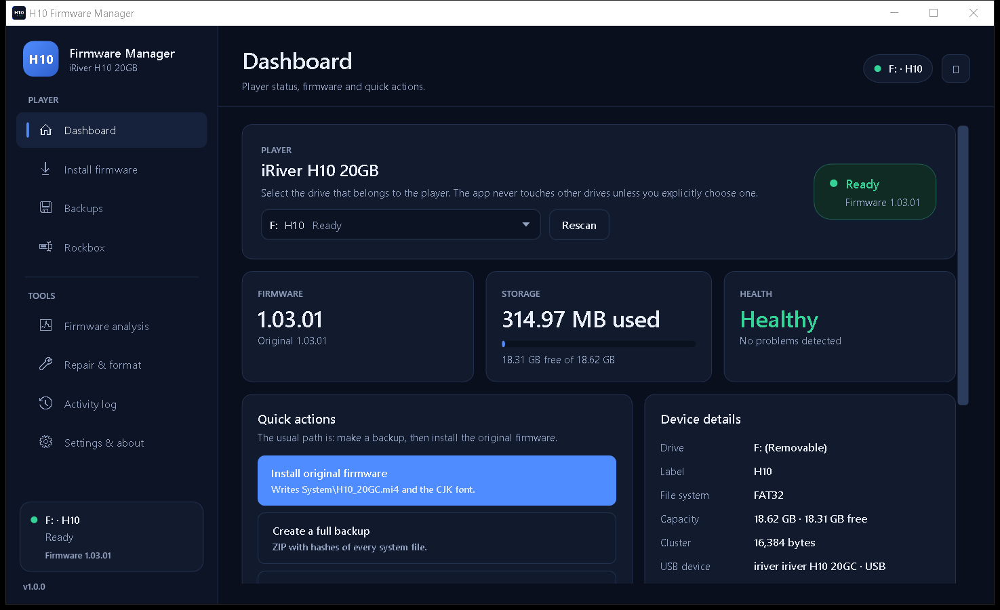
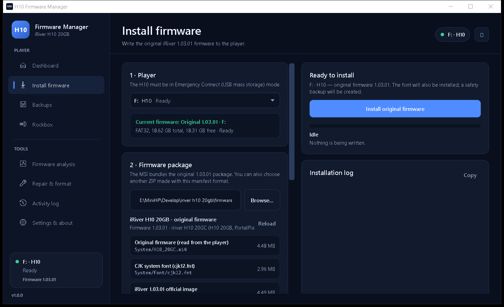
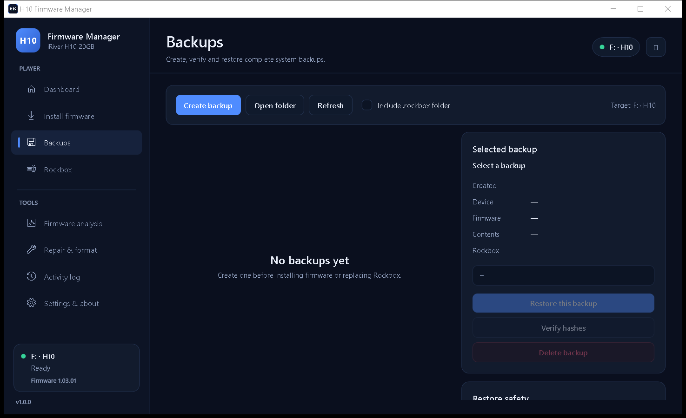
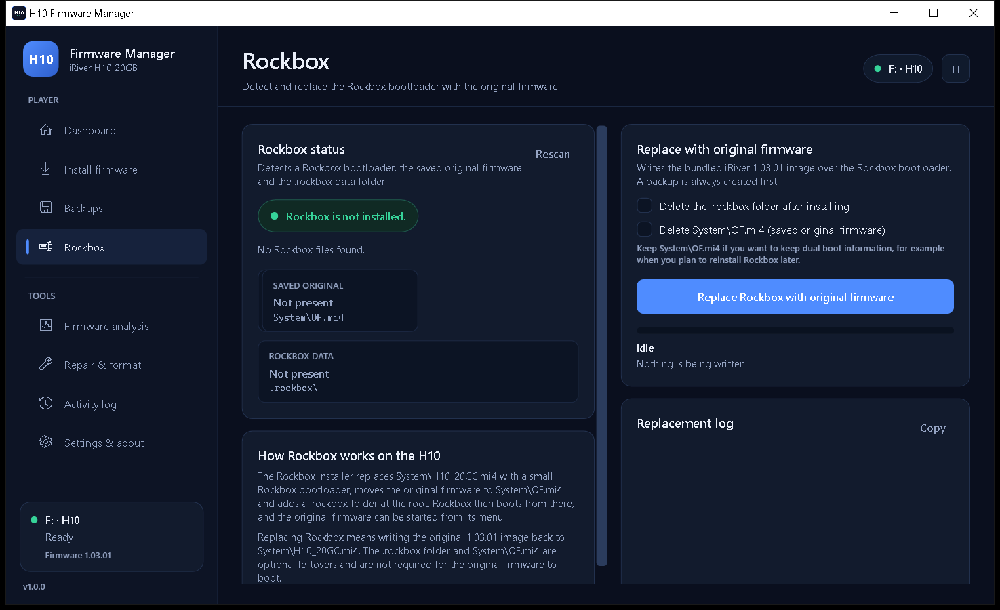
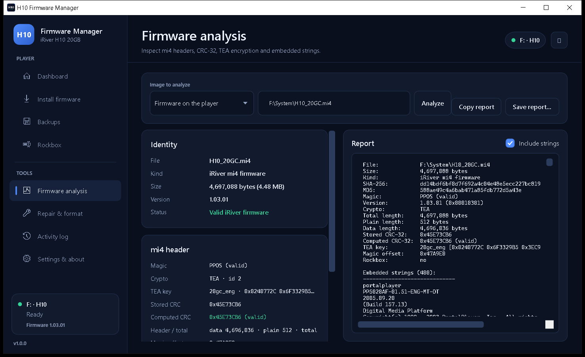
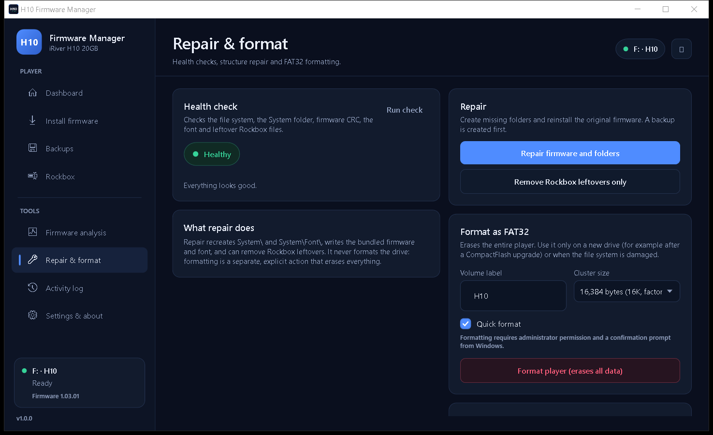
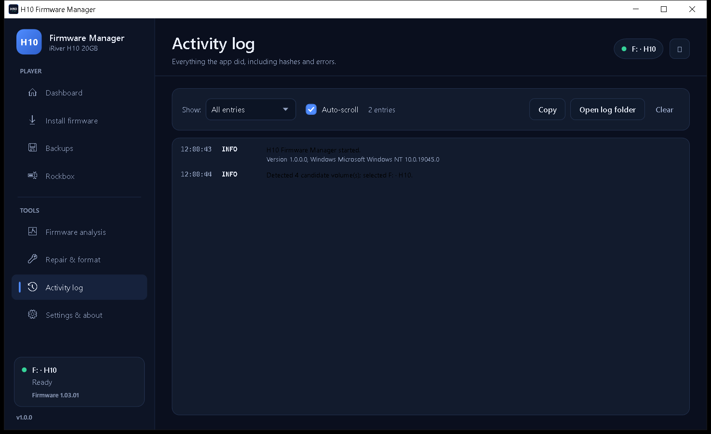
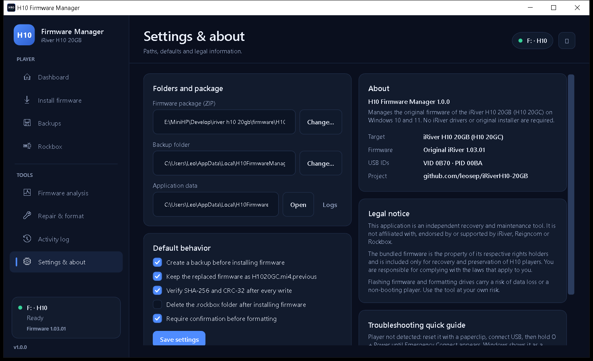

# H10 Firmware Manager

A Windows 10/11 application that installs, backs up, restores, analyses, repairs and formats
the original iRiver firmware on the **iRiver H10 20GB (H10 20GC)** — without the original iRiver
installer, which no longer works on modern Windows.

The MSI installer is self-contained: it ships the application together with the original
iRiver 1.03.01 firmware package (`firmware\H10-20GC_original_1.03.01.zip`) inside the same
installer, so firmware can be restored offline on a freshly formatted or misbehaving player.

> The firmware is the property of iRiver/Reigncom. It is bundled only for recovery and
> preservation of H10 players. See [docs/legal.md](docs/legal.md).

---

## Contents

- [Why this exists](#why-this-exists)
- [Features](#features)
- [Supported player](#supported-player)
- [Screenshots](#screenshots)
- [Download and install](#download-and-install)
- [Quick start](#quick-start)
- [The firmware package](#the-firmware-package)
- [Rockbox](#rockbox)
- [CompactFlash upgrade](#compactflash-upgrade)
- [Documentation](#documentation)
- [Repository layout](#repository-layout)
- [Build from source](#build-from-source)
- [Verifying a download](#verifying-a-download)
- [Status and limitations](#status-and-limitations)
- [Legal notice](#legal-notice)

---

## Why this exists

The H10 20GB is a 2005 hard-disk player (PortalPlayer PP5020). Its firmware lives on the
player's own FAT32 volume as `\System\H10_20GC.mi4`. Two things make recovery painful today:

1. The official iRiver updater requires old Windows drivers and a proprietary USB mode.
2. Rockbox and hard-drive failures frequently leave the player without a bootable firmware,
   and the original firmware is no longer downloadable from iRiver.

But the player can expose its internal disk as a normal **USB mass-storage drive** in
*Emergency Connect* mode. That is all this tool needs: it writes a verified firmware image
directly to `\System\H10_20GC.mi4`, exactly where the bootloader looks for it.

## Features

| Area | What it does |
| --- | --- |
| **Install** | Writes the original iRiver 1.03.01 firmware and the CJK font. Creates `\System` and `\System\Font` when they are missing, so it works on a blank or freshly formatted drive. |
| **Replace Rockbox** | Detects a Rockbox bootloader (`RBBL` at `0x1F8`), the saved original (`\System\OF.mi4`) and the `.rockbox` folder, then restores the original firmware. Optionally removes the leftovers. |
| **Backups** | Creates verified ZIP backups of the whole `\System` tree (and optionally `.rockbox`), with SHA-256 hashes for every file. Restore, verify and delete from the app. |
| **Analyse** | Decodes the mi4 header: magic, version, lengths, CRC-32, crypto type, TEA key, SHA-256/MD5 and embedded strings. |
| **Repair** | Health check of the volume, `System` folder, firmware CRC, font and Rockbox leftovers, plus one-click structure repair. |
| **Format** | Erases the volume and reformats it as FAT32 with the `H10` label and 16 KB clusters (the factory layout). Intended for new CompactFlash drives and damaged file systems. |
| **Safety** | Every write goes through a temporary file, SHA-256/CRC verification and an atomic replace. A backup is created before installs, repairs and restores. Nothing is written without explicit confirmation. |
| **No drivers** | Uses only the standard Windows USB mass-storage driver. No WMI, no iRiver software, no MTP. |

## Supported player

| | |
| --- | --- |
| Model | iRiver H10 20GB — model code **H10 20GC** |
| Chipset | PortalPlayer PP5020 |
| USB identity | VID `0B70`, PID `00BA` (`iriver iriver H10 20GC USB Device`) |
| Mode | **Emergency Connect** (UMS) — appears as a normal disk labelled `H10` |
| File system | FAT32, 512-byte sectors, 16,384-byte clusters |
| Firmware file | `\System\H10_20GC.mi4` (PPOS / mi4 container, TEA encrypted) |

The H10 **5GB** (H10 5GC) and the H10 **20GB "H10 20GB" variants with a different model code**
are **not** supported: they use different firmware files and must not be flashed with these
images. See [docs/compatibility.md](docs/compatibility.md).

## Screenshots

| Dashboard | Install firmware |
| --- | --- |
|  |  |

| Backups | Rockbox |
| --- | --- |
|  |  |

| Firmware analysis | Repair and format |
| --- | --- |
|  |  |

| Activity log | Settings |
| --- | --- |
|  |  |

## Download and install

1. Download `H10FirmwareManager-1.0.0-x64.msi` from the
   [Releases page](https://github.com/leosep/iRiverH10-20GB/releases).
2. Run it. Windows asks for administrator permission because the app installs to
   `C:\Program Files\H10 Firmware Manager`.
3. The installer places:
   - `H10FirmwareManager.exe` — the self-contained application (no .NET install required);
   - `firmware\H10-20GC_original_1.03.01.zip` — the bundled original firmware package;
   - Start menu and desktop shortcuts.
4. Windows 10 or 11, 64-bit, is required.

Uninstall from **Settings → Apps → Installed apps**. Your backups and settings live in
`%LOCALAPPDATA%\H10FirmwareManager` and are not removed.

## Quick start

1. **Connect the player in Emergency Connect mode**
   - Power the player off.
   - Connect the USB cable.
   - Hold the **O** button and press **Power**, and keep holding until the player shows
     `Emergency Connect...`.
   - Windows mounts it as a drive labelled **H10**.
2. Start **H10 Firmware Manager**. The dashboard should show the drive, `FAT32`, the capacity
   and the current firmware state.
3. Open **Install firmware** and click **Install original firmware 1.03.01**.
4. Wait for the progress bar to reach *Complete*, then safely eject the player and power it on.

Detailed instructions and troubleshooting: [docs/install.md](docs/install.md).

## The firmware package

`firmware\H10-20GC_original_1.03.01.zip` contains:

| Path | Purpose |
| --- | --- |
| `System/H10_20GC.mi4` | Original iRiver 1.03.01 system image, read from a working H10 20GB. |
| `System/Font/cjk12.fnt` | CJK system font used by the player. |
| `recovery/burnkey/H10_20GC_image.mi4` | The same 1.03.01 system image as shipped in iRiver's official update package. |
| `recovery/burnkey/H10_20GC.mi4` | *BURN KEY* loader from the official package (advanced bootloader recovery only). |
| `recovery/burnkey/BL_H10_20GC.hex` | Encrypted bootloader from the official package (advanced recovery only). |
| `recovery/burnkey/firmware.inf` | Original install manifest, kept as reference. |
| `manifest.json` | Machine-readable package description with sizes, hashes and mi4 metadata. |
| `README.txt` | Short plain-text instructions. |

Recommended entries, installed by default:

| File | Size | SHA-256 | CRC-32 |
| --- | --- | --- | --- |
| `System/H10_20GC.mi4` | 4,697,088 | `dd14bdf6bf0d7f692a4c04e48e5ecc227bc819a19d1d89e323bbd70796d18a36` | `0x45E73CB6` |
| `System/Font/cjk12.fnt` | 3,103,341 | `9fe60b3ae16e643b8fd6ff0656553fdebac7f0eb47ed1f58e0cfd86180d32038` | – |
Package ZIP SHA-256: `0239cbb36048040ead6bdbf5a5af59ac59ae515ea85b58babc1f778a4bc652ba`.

The package format is documented in [docs/firmware-format.md](docs/firmware-format.md); the
package can be regenerated with [`tools/New-FirmwarePackage.ps1`](tools/New-FirmwarePackage.ps1).

## Rockbox

When Rockbox is installed, it takes over `\System\H10_20GC.mi4` with its own bootloader and
moves the original firmware to `\System\OF.mi4`. The **Rockbox** page detects this state and
can put the original firmware back, optionally deleting the `.rockbox` folder and `OF.mi4`.
Rockbox itself is not bundled or redistributed. See [docs/rockbox.md](docs/rockbox.md).

## CompactFlash upgrade

The 20 GB mechanical drive can be replaced with a CompactFlash card plus a CE/ZIF adapter.
This project documents one known-good combination, including the exact parts:

- **SMART SG9CF16GHYCB XceedCF 16 GB CompactFlash**
- **CF to CE ZIF to CF 1.8" adapter with two cables**

Both are shown in [docs/cf-mod.md](docs/cf-mod.md), together with the format-and-reinstall
procedure and the exact FAT32 geometry needed.

## Documentation

| Document | Contents |
| --- | --- |
| [Install guide](docs/install.md) | Emergency Connect, installing, verifying, ejecting. |
| [Compatibility](docs/compatibility.md) | Supported models, requirements, what is not supported. |
| [Rockbox](docs/rockbox.md) | How Rockbox changes the player, and how to revert. |
| [Recovery](docs/recovery.md) | Player will not boot, drive not detected, bootloader recovery. |
| [CompactFlash mod](docs/cf-mod.md) | HDD → CF replacement with photos and firmware reinstall. |
| [Firmware format](docs/firmware-format.md) | mi4 header layout, CRC-32, TEA variant, Rockbox detection. |
| [Legal](docs/legal.md) | Firmware ownership, warranty and risk. |

## Repository layout

```
src/
  H10FirmwareManager.Core/     firmware format, devices, services (no UI)
  H10FirmwareManager/          WPF application (dark theme, 8 pages)
tests/
  H10FirmwareManager.SelfTest/ end-to-end self-test on simulated volumes
installer/
  H10FirmwareManager.wxs       WiX v7 project (MSI with embedded firmware ZIP)
firmware/
  H10-20GC_original_1.03.01.zip
tools/
  Build-Release.ps1            self-test, publish, MSI, hashes
  New-FirmwarePackage.ps1      regenerate the firmware ZIP
docs/
  images/                      application screenshots and hardware photos
```

## Build from source

Requirements:

- Windows 10/11 x64
- [.NET 9 SDK](https://dotnet.microsoft.com/download)
- [WiX Toolset v7 CLI](https://wixtoolset.org/) (`wix` on `PATH`)
- Windows PowerShell 5.1 (included with Windows)

Full release build (self-test → publish → MSI → hashes):

```powershell
.\tools\Build-Release.ps1
```

Outputs to `artifacts\release`:

- `H10FirmwareManager-1.0.0-x64.msi`
- `H10-20GC_original_1.03.01.zip`
- `SHA256SUMS.txt`

Build and run just the application (development):

```powershell
dotnet build src\H10FirmwareManager\H10FirmwareManager.csproj
```

Run the self-test:

```powershell
dotnet run --project tests\H10FirmwareManager.SelfTest -c Debug -- selftest
```

The self-test verifies the CRC-32 and TEA implementations, validates the bundled package,
and simulates install, backup/restore and Rockbox replacement on a temporary directory.

## Verifying a download

Always compare the SHA-256 of the downloaded files. Windows:

```powershell
Get-FileHash .\H10FirmwareManager-1.0.0-x64.msi -Algorithm SHA256
Get-FileHash .\H10-20GC_original_1.03.01.zip -Algorithm SHA256
```

The release page publishes a `SHA256SUMS.txt` next to the assets. The firmware ZIP in this
repository has SHA-256:

```
0239cbb36048040ead6bdbf5a5af59ac59ae515ea85b58babc1f778a4bc652ba
```

## Status and limitations

- The firmware format, CRC-32 and TEA implementation are validated against the real image and
  against an independent reference implementation; the self-test covers install, backup,
  restore and Rockbox replacement on simulated volumes.
- **Firmware install and format were intentionally not executed against physical hardware while
  preparing this release.** They are guarded by confirmation prompts and by a safety backup.
  If you use them, you accept the risk described in [docs/legal.md](docs/legal.md).
- The format feature uses `format.com` through an elevated helper; the app is not itself
  elevated. Windows shows its own UAC prompt when formatting.
- MTP mode is not supported; the player must be in Emergency Connect (UMS) mode.
- Only the H10 20GB (H10 20GC) is supported. Other H10 variants use different firmware.

## Legal notice

This is an independent recovery and preservation project. It is not affiliated with, endorsed
by or supported by iRiver, Reigncom or the Rockbox project. The bundled firmware is the property
of its rights holders and is included only for recovery and preservation of H10 players.
Flashing firmware and formatting drives can destroy data or leave a player unbootable — use at
your own risk. Full text: [docs/legal.md](docs/legal.md).
