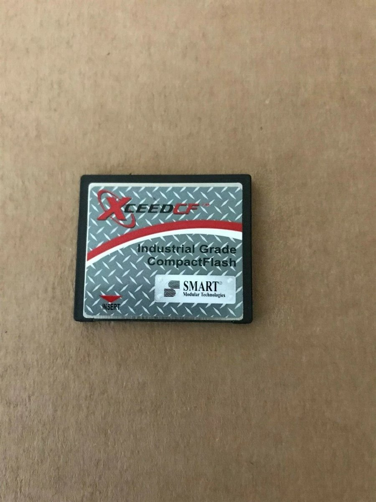
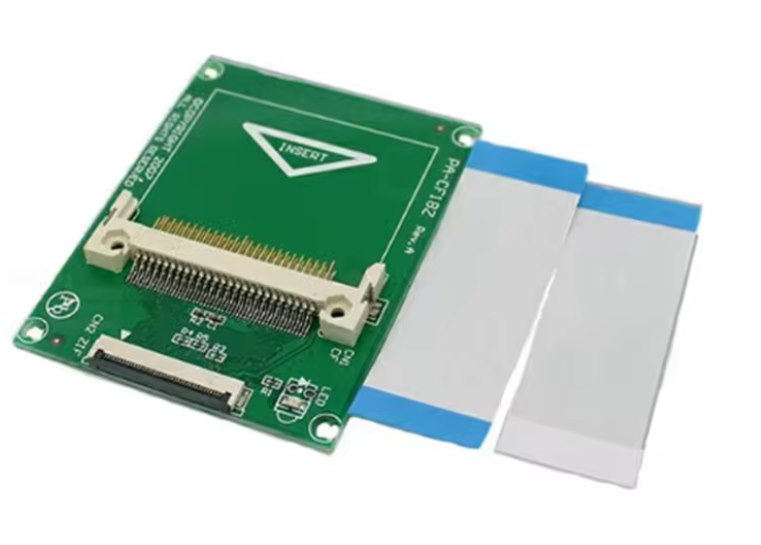

# Replacing the hard drive with a CompactFlash card

The H10 20GB uses a 1.8-inch **ZIF** hard drive. After almost twenty years these drives are noisy,
slow, fragile and often the first part to fail. Replacing the drive with a CompactFlash card and a
ZIF-to-CF adapter makes the player silent, faster, lighter and far more reliable — and this app can
format the new card and reinstall the original firmware.

This page documents one **known-good parts combination** and the complete procedure.

---

## Parts

### 1. CompactFlash card

**SMART SG9CF16GHYCB — XceedCF Industrial Grade CompactFlash, 16 GB**

- Industrial-grade CF card (SMART Modular Technologies), designed for embedded devices with many
  write cycles.
- 16 GB is a good match for the 20 GB player: plenty of space for music, and the H10 handles it
  without trouble.
- Prefer **industrial / embedded** CF cards over cheap consumer cards. They handle power loss and
  wear much better, which matters in a portable player.

> A 16 GB card will report slightly less usable space than the original 20 GB drive. That is
> normal; the firmware does not depend on the exact capacity.

### 2. ZIF-to-CF adapter

**CF to CE ZIF to CF Interface, 1.8" Compact Flash / CF Memory Card to CE adapter for Toshiba
iPod ZIF SSD HDD, with 2 cables**

- Converts the player's 1.8" ZIF connector into a standard CF slot.
- The kit includes **two ZIF ribbon cables**; use the one whose pin count and width match the
  player's mainboard connector. The other is a spare for a different device.
- The adapter is unpowered and passive: the CF card appears to the player exactly like a disk.

### Tools

- Small Phillips screwdriver matching the H10 case screws.
- Plastic pry tool or guitar pick.
- Tweezers.
- An anti-static wrist strap, or touch a grounded metal surface before working.

---

## Before you start

> **Warning:** opening the player voids any remaining warranty and carries a real risk of damage.
> The ZIF ribbon cable and its connector are delicate. Work slowly, and never pull on the ribbon
> itself.

1. **Back up the player first.** Connect it in Emergency Connect mode and use the **Backups**
   page. Keep the ZIP on your PC, not on the player.
2. Power the player off and let it discharge for a few minutes.
3. Work on a clean, well-lit, non-carpeted surface.

## Procedure

1. **Open the case.** Remove the screws on the back of the H10 and carefully separate the shell.
   Keep the screws in a cup — they are small and easy to lose.
2. **Disconnect the battery** if your unit's battery connector is accessible. This prevents
   accidental shorts while you work.
3. **Locate the hard drive.** It sits in a thin metal or plastic frame with a short ZIF ribbon
   cable going to the mainboard.
4. **Release the ZIF connector.** On the mainboard side, flip up the locking bar (or slide the
   latch, depending on the connector) before pulling the ribbon out. Never pull a ZIF ribbon while
   the latch is closed — that is how the connector gets destroyed.
5. **Remove the drive** from its frame and set it aside.
6. **Fit the adapter.** Connect the adapter's ZIF ribbon to the mainboard connector, latch it, and
   route the ribbon so it is not pinched by the case. Connect the other end to the adapter board.
7. **Insert the CompactFlash card** into the adapter until it seats. The card's `INSERT` arrow
   points toward the adapter's connector.
8. **Test before closing.** Leave the case open, connect USB, and enter Emergency Connect mode.
   Windows should show a new disk. If it does not, recheck the ribbon orientation and the latch.
9. **Close the player** once the drive is detected.

## Format the new card

A new CF card may be unformatted, or formatted with a file system the player does not like. Use the
app to give it the factory layout.

1. Connect the player in Emergency Connect mode and select it in **H10 Firmware Manager**.
2. Open **Repair & format**.
3. Set:
   - **Volume label**: `H10`
   - **Cluster size**: `16,384 bytes (16K, factory)`
   - **Quick format**: off for a brand-new card (it also checks for bad blocks); on afterwards.
4. Click **Format player (erases all data)** and confirm twice, then approve the UAC prompt.
5. Wait for *Format complete*. The summary shows the new label, cluster size and capacity.

## Install the firmware

A formatted card has no `\System` folder, so the player has nothing to boot yet.

1. Open **Install firmware**.
2. The bundled package is already selected. Click **Install original firmware 1.03.01**.
3. The app creates `\System` and `\System\Font`, writes the firmware and the font, and verifies
   both.
4. Safely eject, unplug USB, and power on. The player boots the original iRiver firmware from the
   CompactFlash card.

## Expected result

| Before | After |
| --- | --- |
| 1.8" 20 GB ZIF hard drive | 16 GB CompactFlash card |
| Audible spinning/clicking | Silent |
| Slow seek times, fragile | Fast, shock-resistant |
| Format `H10`, 16K clusters | Same layout, recreated by the app |

## Notes and troubleshooting

- **Card not detected:** re-seat the ZIF ribbon and make sure the latch is closed. Check that the
  ribbon is inserted the right way round (contacts facing the correct side).
- **Detected but Windows says RAW:** format it from the app, as above.
- **Format fails repeatedly:** the adapter or card may be faulty. Try the second ribbon cable, then
  another card.
- **Player boots but shows a white screen / hangs:** the firmware install did not complete. Repeat
  the firmware install; see [recovery.md](recovery.md).
- **Only a smaller capacity is reported:** some adapters and cards negotiate a lower capacity.
  Reformat and reinstall; if it persists, the card or adapter is not fully compatible.
- **Battery life:** a CF card typically uses less power than the old drive, but the adapter adds a
  small overhead. Expect similar or slightly better runtime.
